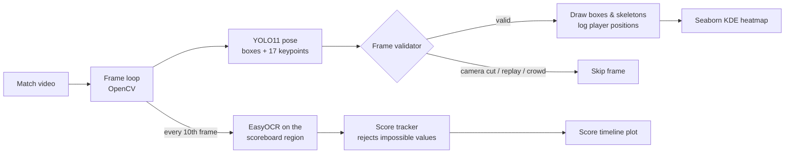

# Table Tennis Analyzer

Computer-vision analysis of table tennis match footage: tracks both players with **YOLO11 pose estimation**, draws their skeletons on the video, builds a **court-position heatmap** and reads the on-screen **scoreboard with OCR** to plot how the score develops over the match.

**[▶ Demo video](https://ofekzagury.github.io/videos/table-tennis-analyzer.mp4)**: the analyzer run on 45 seconds of a Korea Table Tennis League broadcast, showing the pose skeletons, the skipped camera cuts, the position heatmap and the score timeline (footage credit below).

## What it produces

| Output | Description |
|---|---|
| `output_with_detections.mp4` | The input video with player bounding boxes, joints and skeleton lines |
| `player_positions.csv` | Per-frame centre position of the left and right player |
| `player_position_heatmap.png` | Kernel-density heatmap of where both players stood, drawn over the first frame |
| `player_scores.csv` | Scores read from the scoreboard every 10 frames |
| `score_progression.png` | Score timeline for both players |

## How it works



- **Player identification** – detections are sorted by x position, so the leftmost and rightmost person are tracked as player 1 and player 2; spectators and umpires in between are ignored.
- **Frame validation** – the first valid frame becomes a reference. Later frames are accepted only if the two players are far enough apart, at a plausible height and size, and close to their reference positions. This filters out close-ups, replays and crowd shots that broadcast footage is full of.
- **Scoreboard OCR** – the bottom-left scoreboard region is read with EasyOCR, common OCR mistakes (`O` → `0`) are corrected, and implausible scores are discarded by the score tracker.

## Getting started

**Requirements:** Python 3.10+. A GPU is optional (CPU works, just slower).

```bash
git clone https://github.com/OfekZagury/table_tennis_analyzer.git
cd table_tennis_analyzer
python -m venv .venv
source .venv/bin/activate          # Windows: .venv\Scripts\activate
pip install -r requirements.txt

python table_tennis_analyzer.py --input match.mp4                # first 600 frames
python table_tennis_analyzer.py --input match.mp4 --end-frame 0  # whole video
```

The YOLO11 pose weights (`yolo11s-pose.pt`) are downloaded automatically on the first run.

| Option | Default | Description |
|---|---|---|
| `--input` | `input.mp4` | Path to the match video |
| `--start-frame` | `0` | First frame to process |
| `--end-frame` | `600` | Last frame to process (`0` = until the end) |

The scoreboard region is tuned for broadcasts that show the score in the bottom-left corner; adjust `get_scoreboard_region()` for other layouts.

## Tech stack

Ultralytics YOLO11 (pose), OpenCV, EasyOCR, pandas, Matplotlib, Seaborn.

## Credits

Demo video match footage: KTTL 한국프로탁구리그 (한국실업탁구연맹), licensed [CC BY 3.0](https://creativecommons.org/licenses/by/3.0), via [Wikimedia Commons](https://commons.wikimedia.org/wiki/File:%EC%96%91%EC%82%B0%EC%8B%9C%EC%B2%AD_%EC%9D%B4%EC%98%81%EC%9D%80,_%EB%B0%95%EB%AF%BC%EC%A3%BC_vs_%EC%88%98%EC%9B%90%ED%8A%B9%EB%A1%80%EC%8B%9C%EC%B2%AD_%EA%B3%BD%EC%88%98%EC%A7%80,_%EC%9C%A0%EB%8B%A4%ED%98%84_-%ED%92%80%EB%B2%84%EC%A0%84_-_1080.webm); cut and annotated.
